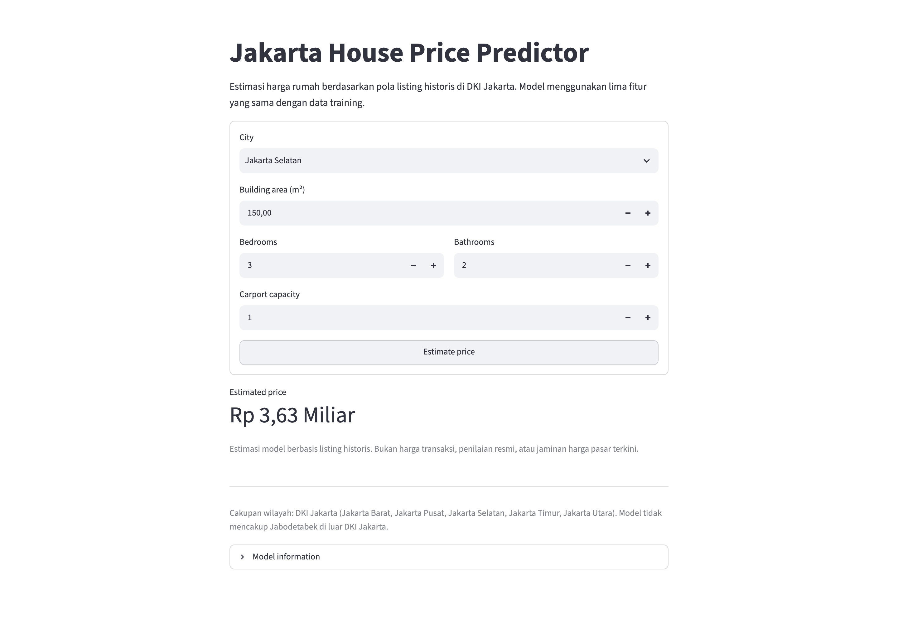
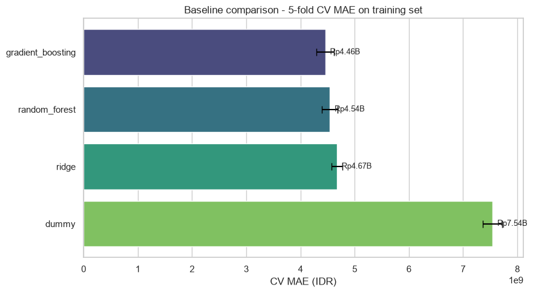
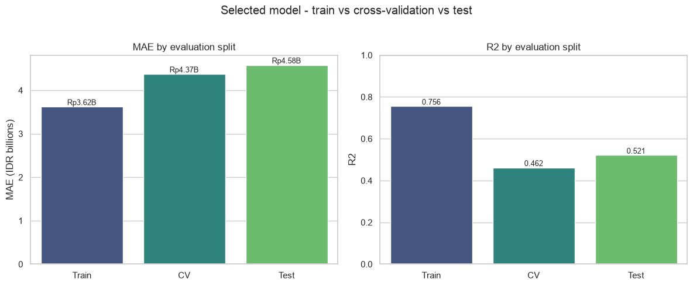
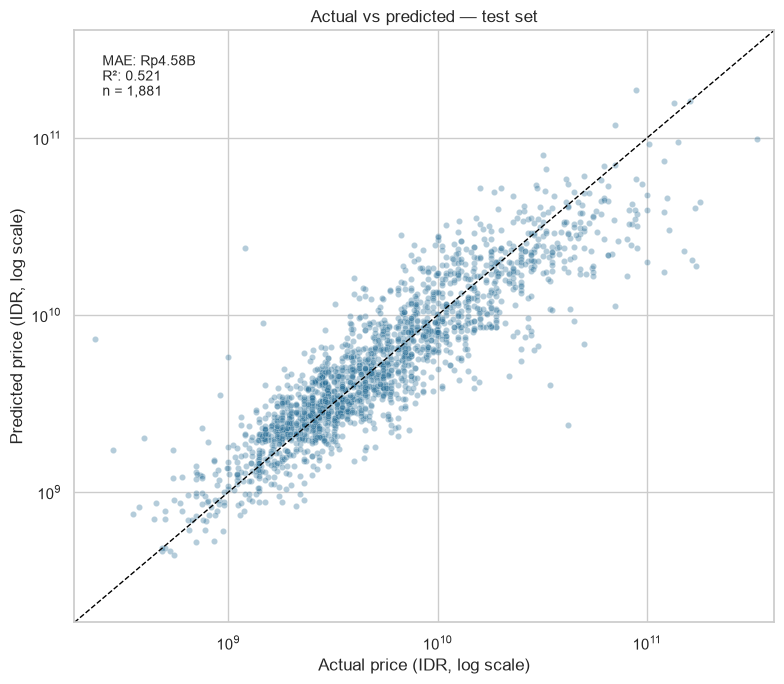
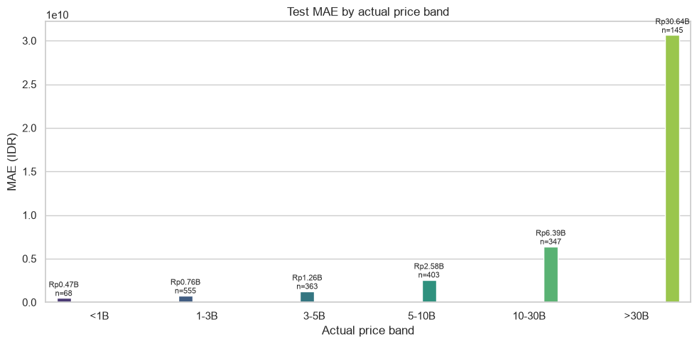
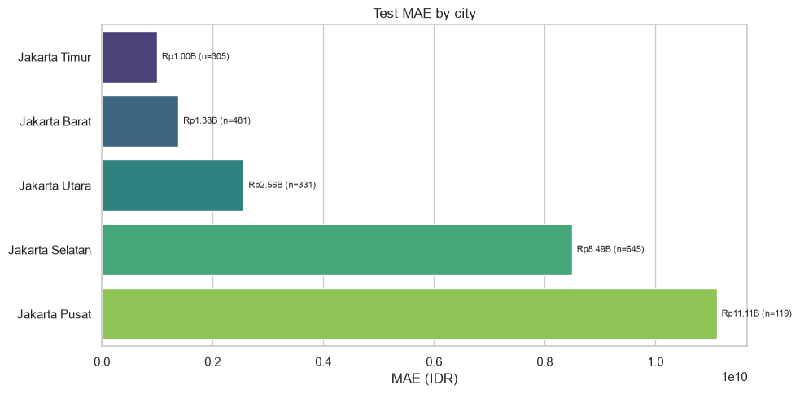
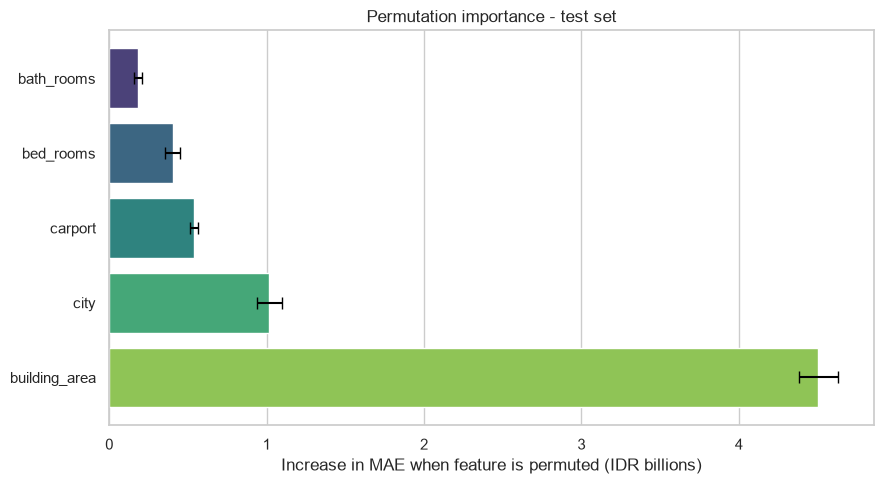
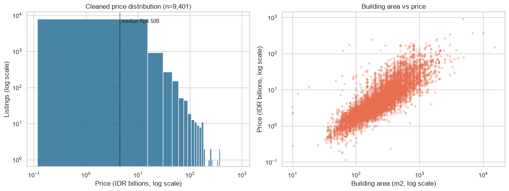

# Jakarta House Price Predictor

An end-to-end machine learning project that estimates house listing prices in DKI Jakarta,
Indonesia. The project covers data acquisition, cleaning, exploratory analysis, baseline
models, cross-validation, hyperparameter tuning, a single final test evaluation, and an
interactive Streamlit application.



## 1. Project Overview

This is a supervised regression project. A scikit-learn pipeline predicts the price of one
house listing from five inputs:

- city
- building area
- number of bedrooms
- number of bathrooms
- carport capacity

The final artifact combines preprocessing and the trained model in one joblib file. The
Streamlit app loads that artifact and returns an estimate in Rupiah.

The reported results come from one recorded experiment. They are not a claim of production
readiness or of transaction-price accuracy.

## 2. Problem Statement

Given a house listing in DKI Jakarta, estimate its asking price in Rupiah from a small,
user-provided feature set.

The primary metric is **mean absolute error (MAE)** in Rupiah. RMSE and R² are reported as
secondary metrics. Model selection uses 5-fold cross-validation on the training set only.
The test set is evaluated once, after the model has been selected.

## 3. Dataset

| Item | Value |
|---|---|
| Source | [Jakarta House Price Dataset on Kaggle](https://www.kaggle.com/datasets/abiyyurasyiq/jakarta-house-price-dataset) |
| Dataset identifier | `abiyyurasyiq/jakarta-house-price-dataset` |
| License | MIT, as listed on the dataset card |
| Raw size | 10,000 rows × 9 columns |
| Clean size | 9,401 rows × 9 columns |
| Target | `price` in Rupiah |
| Raw file | `data/raw/jakarta_house.csv` (not committed) |
| Clean file | `data/processed/train_clean.csv` (not committed) |

The raw and processed CSV files are excluded from Git. The repository contains the download
and preparation scripts, so the dataset can be recreated locally. Review the source license
before redistributing the data.

## 4. Geographic Scope and Dataset Period

The dataset covers **DKI Jakarta only**:

- Jakarta Barat
- Jakarta Pusat
- Jakarta Selatan
- Jakarta Timur
- Jakarta Utara

It contains 253 districts, but district is not used as a model feature. The model does not
cover Bogor, Depok, Tangerang, Bekasi, or any area outside DKI Jakarta, and the app does not
offer those locations.

The dataset has no date or year column. It is a static listing snapshot downloaded on
2026-10-20. The listing period is not encoded, so this project makes no claims about a
specific market period or about current market prices.

## 5. Features

| Feature | Type | Description | Used by model |
|---|---|---|---|
| `city` | Categorical | City within DKI Jakarta | Yes |
| `building_area` | Numeric | Building area in square metres | Yes |
| `bed_rooms` | Numeric | Number of bedrooms | Yes |
| `bath_rooms` | Numeric | Number of bathrooms | Yes |
| `carport` | Numeric | Carport capacity | Yes |
| `district` | Categorical | District / kecamatan | No (high cardinality; EDA only) |
| `land_area` | Numeric | Land area in square metres | No (reserved for a later experiment) |
| `index` | Identifier | Row index from the source file | No |

The five model features are fixed in `src/train.py` and shared by training, inference, and
the Streamlit UI.

## 6. Data Cleaning and EDA

Cleaning rules and row counts are recorded in `results/cleaning_report.json`.

| Step | Rows before | Rows after | Removed |
|---|---:|---:|---:|
| Raw data | 10,000 | 10,000 | 0 |
| Remove exact duplicate listings | 10,000 | 9,474 | 526 |
| Remove missing, zero, or negative prices | 9,474 | 9,474 | 0 |
| Remove prices below Rp100,000,000 | 9,474 | 9,461 | 13 |
| Remove missing or invalid building area (<10 m²) | 9,461 | 9,401 | 60 |

Additional decisions:

- `bed_rooms == 0` and `bath_rooms == 0` are treated as missing and imputed by the training
  pipeline (190 and 187 values).
- `carport == 0` is kept because zero carport capacity is meaningful.
- High-priced homes are kept. The target is modeled on a log scale instead of removing the
  luxury segment.
- All imputation and transformation statistics are learned inside the training pipeline, not
  from the test set.

After cleaning, the median price is **Rp4.50 billion**, the maximum is **Rp900 billion**, and
the target remains strongly right-skewed (skewness about 13.76). The EDA notebook and figures
cover the target distribution, price by city, listings by location, missing values and
duplicates, building area vs price, rooms and carport vs price, correlations, outliers, and
cleaning impact.

- Notebook: `notebooks/01_eda.ipynb`
- Figures: `results/figures/01_*.png` through `09_*.png`

## 7. Modeling Methodology

The data is split into 80% training and 20% test rows with `random_state=42`
(7,520 training rows and 1,881 test rows).

Preprocessing:

- Numeric features: median imputation, then a Yeo-Johnson power transform.
- `city`: most-frequent imputation, then one-hot encoding with
  `handle_unknown="ignore"`.
- Target: `log1p(price)` inside a `TransformedTargetRegressor`; predictions are converted
  back to Rupiah exactly once with `expm1`.

Models compared in the baseline stage:

- Dummy regressor (median)
- Ridge regression
- Random Forest
- Gradient Boosting

Model selection uses 5-fold shuffled cross-validation on the training set with
`random_state=42`. The selection rule is **lowest CV MAE**, with RMSE and R² as tie-breakers.

Tuning spaces:

- Random Forest: 300/500 trees, max depth `None`/20/40, minimum leaf size 1/2/4, max
  features `sqrt` (18 candidates).
- Gradient Boosting: 200/400 estimators, learning rate 0.05/0.1, max depth 2/3,
  subsample 0.8/1.0 (16 candidates).

The test set is not used for preprocessing, tuning, or model selection. It is evaluated once
after selection in `src/train.py --evaluate`. The command refuses to overwrite an existing
final evaluation unless `--force` is supplied.

## 8. Baseline Comparison

All values are 5-fold cross-validation metrics on the training set, in Rupiah.

| Model | CV MAE | CV RMSE | CV R² |
|---|---:|---:|---:|
| Gradient Boosting | **4,456,061,312** | 15,070,576,876 | 0.4505 |
| Random Forest | 4,540,647,765 | 14,948,410,192 | 0.4578 |
| Ridge | 4,671,027,365 | 15,447,049,646 | 0.4176 |
| Dummy (median) | 7,541,252,926 | 20,860,202,218 | -0.0838 |

Gradient Boosting had the lowest CV MAE. Random Forest had a slightly lower CV RMSE and
higher CV R² but a much larger train-vs-CV gap, which is an overfitting signal. Ridge became
stable after the Yeo-Johnson transform; without it, extreme building areas produced
unstable inverse-transformed predictions.



## 9. Evaluation Metrics

- **MAE (primary):** average absolute error in Rupiah. It is easy to interpret but sensitive
  to the luxury segment.
- **RMSE:** penalizes large errors more strongly than MAE.
- **R²:** proportion of price variance explained on the evaluated split.

All metrics are computed after converting predictions back to Rupiah. The same metric
contract is used for cross-validation and the final test evaluation.

## 10. Best Model and Results

The selected model is a tuned **Gradient Boosting Regressor**.

Best parameters:

```text
learning_rate=0.1, max_depth=3, n_estimators=400, subsample=0.8
```

| Evaluation | MAE | RMSE | R² |
|---|---:|---:|---:|
| Train | Rp3,618,904,193 | Rp10,174,635,735 | 0.7555 |
| 5-fold CV (training set) | Rp4,370,866,728 ± Rp142,688,111 | Rp14,905,937,070 | 0.4620 |
| Final test | **Rp4,579,679,052** | **Rp13,397,199,018** | **0.5215** |

The test MAE is about Rp0.96 billion higher than the train MAE, and test R² is about 0.234
lower than train R². The model therefore still overfits somewhat, but it clearly beats the
Dummy baseline and retains useful signal on unseen rows.

Test R² of 0.5215 means that roughly 48% of the variance in the test set remains unexplained.
The model is an estimator for historical listing patterns, not a valuation tool.





### Error analysis

Absolute errors grow sharply with price:

| Actual price band | n | MAE |
|---|---:|---:|
| < Rp1B | 68 | Rp0.47B |
| Rp1–3B | 555 | Rp0.76B |
| Rp3–5B | 363 | Rp1.26B |
| Rp5–10B | 403 | Rp2.58B |
| Rp10–30B | 347 | Rp6.39B |
| > Rp30B | 145 | Rp30.64B |

| City | n | MAE |
|---|---:|---:|
| Jakarta Pusat | 119 | Rp11.11B |
| Jakarta Selatan | 645 | Rp8.49B |
| Jakarta Utara | 331 | Rp2.56B |
| Jakarta Barat | 481 | Rp1.38B |
| Jakarta Timur | 305 | Rp1.00B |

The city-level differences are driven largely by the price mix. Jakarta Pusat and Jakarta
Selatan contain more high-priced listings, where absolute errors are much larger.





## 11. Feature Importance

Permutation importance on the test set, measured as the increase in MAE when a feature is
shuffled (10 repeats). This analysis was run after model selection and was **not** used to
choose the model.

| Feature | Increase in MAE | Std. dev. |
|---|---:|---:|
| `building_area` | Rp4.50B | Rp0.12B |
| `city` | Rp1.02B | Rp0.08B |
| `carport` | Rp0.54B | Rp0.03B |
| `bed_rooms` | Rp0.40B | Rp0.05B |
| `bath_rooms` | Rp0.18B | Rp0.03B |

Building area is the dominant driver, followed by city. Room counts and carport add less
once size and location are known.



## 12. Installation and Training

Requirements: Python 3.12 and [uv](https://docs.astral.sh/uv/).

```bash
git clone https://github.com/stevian-git/jakarta-house-price-predictor.git
cd jakarta-house-price-predictor
uv sync
```

Recreate the data and experiments:

```bash
uv run python src/fetch_data.py
uv run python src/data_prep.py
uv run python src/train.py
uv run python src/train.py --tune
uv run python src/train.py --evaluate
uv run python src/make_figures.py
```

Notes:

- `src/train.py` without flags runs the baseline comparison.
- `--tune` searches the Random Forest and Gradient Boosting grids, selects the best model by
  CV MAE, and writes `models/model.joblib`.
- `--evaluate` computes the final test metrics and writes `results/metrics.json`. The
  recorded run used it once.
- The repository includes the recorded `results/metrics.json`. A fresh clone that wants to
  reproduce the final evaluation must pass `--force`; use that flag only for an intentional
  rerun.
- `models/model.joblib`, `data/raw/`, and `data/processed/` are gitignored. Run the training
  commands before starting the app.

The notebooks are already executed with outputs:

```bash
uv run jupyter lab
```

### Repository structure

```text
.
├── app/app.py
├── data/                  # local only; gitignored
├── docs/app_screenshot.png
├── models/model.joblib    # local only; gitignored
├── notebooks/
│   ├── 01_eda.ipynb
│   ├── 02_baseline_models.ipynb
│   └── 03_evaluate_tune.ipynb
├── results/
│   ├── baseline_metrics.json
│   ├── cleaning_report.json
│   ├── metrics.json
│   ├── tuning_results.json
│   └── figures/
├── src/
│   ├── fetch_data.py
│   ├── data_prep.py
│   ├── train.py
│   ├── predict.py
│   └── make_figures.py
├── pyproject.toml
├── uv.lock
└── README.md
```

## 13. Running the Streamlit App

The app loads `models/model.joblib` and the valid city list from the trained encoder.

```bash
uv run streamlit run app/app.py
```

Then open `http://localhost:8501`.

Example: Jakarta Selatan, 150 m², 3 bedrooms, 2 bathrooms, 1 carport produces an estimate of
**Rp3.63 billion** in the recorded run. This value is an illustration of the current model,
not a market quote.

The app validates the city and numeric ranges, rejects inputs outside the supported set, and
checks that predictions are finite and nonnegative. It also displays the coverage limitation
and model metrics.

## 14. Results and Screenshots

- `notebooks/02_baseline_models.ipynb` reproduces the baseline CV comparison and matches the
  saved baseline JSON exactly.
- `notebooks/03_evaluate_tune.ipynb` documents the tuning search, reproduces the selected
  model's CV score, and analyzes the saved final evaluation without re-running the test set.
- `src/make_figures.py` regenerates figures 10 and 14–19 from the saved metrics and cleaned
  data. Prediction-level figures 11–13 come from the single final evaluation and are not
  regenerated by that script.



## 15. Limitations and Potential Bias

- **Asking prices, not transaction prices.** The target comes from listings and may not
  reflect final sale prices.
- **No time dimension.** The dataset has no date column, so the model cannot account for
  market changes or inflation.
- **Limited feature set.** Street, condition, certificate, floor, furnished status, and
  facilities are not available. `land_area` and `district` are deliberately excluded from
  the five-feature contract.
- **Large absolute errors at the top of the market.** MAE exceeds Rp30 billion for listings
  above Rp30 billion. Aggregate MAE is dominated by this segment.
- **Uneven city coverage.** Jakarta Pusat has only 119 test rows, so its error estimate is
  less stable than Jakarta Selatan's 645 test rows.
- **Ecological and sampling bias.** The data may not represent all neighborhoods, property
  types, or sellers. The model should not be used for lending, taxation, or formal
  valuation.
- **Single split.** Results come from one 80/20 split. CV reduces selection noise, but the
  final test metrics still depend on that split.
- **Model selection is metric-driven.** MAE was the primary criterion. A different metric or
  a cost-sensitive objective could select a different model.

## 16. Future Improvements

- Add a time-aware dataset and validate temporal generalization.
- Test `land_area`, district, and geospatial features in a documented ablation.
- Compare quantile regression or separate models for the luxury segment.
- Add prediction intervals and calibration analysis.
- Evaluate monotonic constraints so larger building area cannot reduce the estimate.
- Add automated tests for the feature contract, Rupiah formatting, and invalid inputs.
- Package the app with a small CI workflow that reruns the notebooks and checks artifacts.
